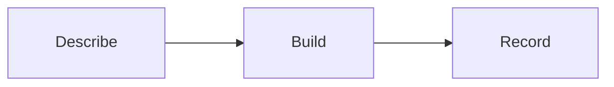

# puddleworks-factory

Builds, tests and validates a swamp extension from a spec. The spec can be a
file, an https URL or inline JSON, and anyone can write one.

| Takes in                                           | Puts out                                      |
| -------------------------------------------------- | --------------------------------------------- |
| an `app-spec/v1`: what to build                    | the extension's files and a `build-result/v1` |
| an `outcome-spec/v1`: what success looks like only | a starter `app-spec/v1` for you to finish     |

The contracts, each with an example, are in `docs/contracts/`:

- [outcome-spec.md](docs/contracts/outcome-spec.md): an agreed request that says
  what success looks like and who agreed it, but not how to build it
- [app-spec.md](docs/contracts/app-spec.md): what Factory builds from
- [build-result.md](docs/contracts/build-result.md): what a build produced and
  where it is

## How it works



1. **Describe** what the app should do.
2. **Build** a starter app in the app's own repo.
3. **Record** a receipt of where it went.

## What is in the package

| Kind     | Name                                       | What it does                                                                                                   |
| -------- | ------------------------------------------ | -------------------------------------------------------------------------------------------------------------- |
| Model    | `@puddleworks/puddleworks-factory/draft`   | `render` reads a spec and writes the extension, its tests, a workflow, the manifest and the app docs           |
| Workflow | `@puddleworks/puddleworks-factory-prefill` | Runs `prefill`: turns an `outcome-spec/v1` into a starter `app-spec/v1`                                        |
| Workflow | `@puddleworks/puddleworks-factory-build`   | Runs `render` on the `puddleworks-factory` instance                                                            |
| Workflow | `@puddleworks/puddleworks-factory-result`  | Runs `result`: writes a `build-result/v1` for the last draft of a spec                                         |
| Skill    | `factory-build`                            | Drives a build end to end: prefill and agree the spec, make the app repo, generate, commit, write a build plan |

## Use

Install the package and create the model instance once:

```bash
swamp extension pull @puddleworks/puddleworks-factory
swamp model create @puddleworks/puddleworks-factory/draft puddleworks-factory
```

### From an outcome spec

Run `/factory-build <path to the outcome spec>` in Claude Code. The skill
prefills an app spec, asks you to confirm the name, inputs, output, settings and
delivery, makes the app's own repo from `puddle-works/puddle-template` if it
does not exist yet (asking first), writes both specs to `spec/` there, and
generates the draft. To prefill by hand instead:

```bash
swamp workflow run @puddleworks/puddleworks-factory-prefill \
  --input outcomeSpec=docs/contracts/outcome-spec.v1.example.json \
  --input out=$HOME/weekly-stock-count.app-spec.json
```

Fill in the blanks the run lists (see
[outcome-spec.md](docs/contracts/outcome-spec.md)), then build from that file.

### From an app spec

Build from a spec on disk, at an https URL, or inline. `targetDir` is a checkout
of the app's own repo and `repository` is its https URL:

```bash
swamp workflow run @puddleworks/puddleworks-factory-build \
  --input spec=docs/contracts/app-spec.v1.example.json \
  --input targetDir=$HOME/dev/obsidian-puddle-scanner \
  --input repository=https://github.com/example/obsidian-puddle-scanner

swamp workflow run @puddleworks/puddleworks-factory-build \
  --input spec=https://example.com/specs/scanner.json \
  --input targetDir=$HOME/dev/obsidian-puddle-scanner \
  --input repository=https://github.com/example/obsidian-puddle-scanner

swamp workflow run @puddleworks/puddleworks-factory-build \
  --input "spec=$(cat spec.json)" \
  --input targetDir=$HOME/dev/obsidian-puddle-scanner \
  --input repository=https://github.com/example/obsidian-puddle-scanner
```

`targetDir` must be a swamp repo (it has a `.swamp.yaml`), such as one made from
`puddle-works/puddle-template`. The draft goes in its root: the extension and
its test in `extensions/models/`, the workflow in `workflows/`, and
`manifest.yaml`, `README.md`, `LICENSE` and an app section in `CLAUDE.md`. An
existing `LICENSE` is kept, and the rest of `CLAUDE.md` is left alone. A spec
that breaks the contract writes nothing and lists every broken rule. Existing
files are kept unless you pass `--input overwrite=true`. The drafted package is
private; pass `--input visibility=public` to publish it publicly.

Once the draft is pushed, write the build result. Add `pullRequest` once the
pull request is open:

```bash
swamp workflow run @puddleworks/puddleworks-factory-result \
  --input name=obsidian-puddle-scanner \
  --input buildRef=draft/obsidian-puddle-scanner \
  --input out=$HOME/obsidian-puddle-scanner.build-result.json
```

## Development

```bash
~/.swamp/deno/deno fmt --check
~/.swamp/deno/deno test -A --permit-no-files
swamp extension quality manifest.yaml
```

## Licence

[MIT](LICENSE)
