# puddleworks-factory

Builds, tests and validates a swamp extension from a spec. The spec can be a
file, an https URL or inline JSON, and anyone can write one.

| Takes in                                           | Puts out                                      |
| -------------------------------------------------- | --------------------------------------------- |
| an `app-spec/v1`: what to build                    | the extension's files and a `build-result/v1` |
| an `outcome-spec/v1`: what success looks like only | a starter `app-spec/v1` for you to finish     |

The contracts, each with an example, are in
[`docs/contracts/`](https://github.com/puddle-works/puddleworks-factory/tree/main/docs/contracts):

- [outcome-spec.md](https://github.com/puddle-works/puddleworks-factory/blob/main/docs/contracts/outcome-spec.md):
  an agreed request that says what success looks like and who agreed it, but not
  how to build it
- [app-spec.md](https://github.com/puddle-works/puddleworks-factory/blob/main/docs/contracts/app-spec.md):
  what Factory builds from
- [build-result.md](https://github.com/puddle-works/puddleworks-factory/blob/main/docs/contracts/build-result.md):
  what a build produced and where it is

Why Factory keeps its own copies of these contracts, and shares no code with the
other Puddleworks apps, is recorded in
[ADR-001](https://github.com/puddle-works/puddleworks-factory/blob/main/docs/adr/ADR-001-three-separate-apps.md).

## How it works

```mermaid
---
config:
  flowchart:
    rankSpacing: 80
    padding: 24
---
flowchart LR
    intake["Intake and reuse"]
    agree["Agree and select target"]
    implement["Generate and implement"]
    validate["Validate"]
    visibility["Decide visibility"]
    review["Independent review"]
    publish["PR and publication"]
    record["Record"]

    intake --> agree --> implement --> validate
    validate --> visibility --> review --> publish --> record
```



1. **Intake and reuse**: read the spec and check it against its contract.
   Looking for an existing extension to reuse is not built yet.
2. **Agree and select target**: from an outcome spec, prefill an app spec and
   agree its open choices; make the app's own repo and a draft branch in it.
3. **Generate and implement**: generate a starter app that passes its own tests,
   | Workflow | `@puddleworks/puddleworks-factory-assess` | Runs `assess`:
   before anything is built, records whether an existing extension method fits
   the outcome exactly, and so whether to write a recipe or workflow for it or
   build an app | then build the behaviour test-first.
4. **Validate**: format, tests, contracts, guardrails and quality all pass.
5. **Decide visibility**: Factory recommends public or private; you decide.
6. **Independent review**: a reviewer that didn't build it checks it against the
   spec, and readiness checks that nothing is left.
7. **PR and publication**: a pull request to the app's repo, then publishing
   once you confirm the readiness summary.
8. **Record**: a build result says where the build went and what was published.

These are the stages in
[the quality and gates plan](https://github.com/puddle-works/puddleworks-factory/blob/main/docs/factory-quality-and-gates-plan.md#lifecycle-and-gates),
which says what each must have before the next.

## What is in the package

| Kind     | Name                                           | What it does                                                                                                                                                                                                                                                                       |
| -------- | ---------------------------------------------- | ---------------------------------------------------------------------------------------------------------------------------------------------------------------------------------------------------------------------------------------------------------------------------------- |
| Model    | `@puddleworks/puddleworks-factory/draft`       | `render` reads a spec and writes the extension, its tests, a workflow, the manifest, the app docs and a CI workflow; `planReview` records a review of the build plan; `visibility` recommends publishing it publicly or privately; `readiness` checks the review before publishing |
| Model    | `@puddleworks/puddleworks-factory/web`         | `serve` shows every app by stage, and each app's records, on a read-only page on 127.0.0.1                                                                                                                                                                                         |
| Workflow | `@puddleworks/puddleworks-factory-prefill`     | Runs `prefill`: turns an `outcome-spec/v1` into a starter `app-spec/v1`                                                                                                                                                                                                            |
| Workflow | `@puddleworks/puddleworks-factory-build`       | Runs `render` on the `puddleworks-factory` instance                                                                                                                                                                                                                                |
| Workflow | `@puddleworks/puddleworks-factory-revise`      | Runs `revise`: takes an app already built to a newly agreed version of its spec, writing the new spec and a change plan, never the code                                                                                                                                            |
| Workflow | `@puddleworks/puddleworks-factory-visibility`  | Runs `visibility`: checks the built app's repo and recommends public or private                                                                                                                                                                                                    |
| Workflow | `@puddleworks/puddleworks-factory-plan-review` | Runs `planReview`: records a review of the build plan against the spec, with the plan's hash, so it stays with that version of the plan                                                                                                                                            |
| Workflow | `@puddleworks/puddleworks-factory-readiness`   | Runs `readiness`: checks the review report and that each acceptance criterion has a test, and writes a one-screen summary                                                                                                                                                          |
| Workflow | `@puddleworks/puddleworks-factory-result`      | Runs `result`: writes a `build-result/v1` for the last draft of a spec, with what was published                                                                                                                                                                                    |
| Skill    | `factory-build`                                | Takes a spec to a published extension: agree the spec, make the app repo, generate, build test-first, check, decide visibility, publish                                                                                                                                            |

## Use

Install the package and create the model instance once, with your own collective
in place of `@YOUR-COLLECTIVE`. Keep the backslash, because swamp otherwise
reads a value starting with `@` as a file to load:

```bash
swamp extension pull @puddleworks/puddleworks-factory
swamp model create @puddleworks/puddleworks-factory/draft puddleworks-factory --global-arg 'typeScope=\@YOUR-COLLECTIVE'
```

`typeScope` is the collective each app is published under: it starts the app's
model type, manifest name and workflow name. It defaults to `@puddleworks`, and
`swamp extension push` refuses a package named for a collective you are not a
member of.

### From an outcome spec

Run `/factory-build <path to the outcome spec>` in Claude Code. It uses these
settings, read from `factory-build.json` at the root of the swamp repo you run
from (a key you leave out keeps its default; an argument such as `org=acme`
overrides for one run):

| Key          | Default                                   | What it sets                                                |
| ------------ | ----------------------------------------- | ----------------------------------------------------------- |
| `org`        | `puddle-works`                            | GitHub organisation or user that owns each app repo         |
| `template`   | `puddle-works/puddle-template`            | Template repo each app repo is made from                    |
| `secrets`    | `["SWAMP_API_KEY", "SWAMP_SIGNIN_TOKEN"]` | Org Actions secrets granted to a new repo; `[]` grants none |
| `collective` | `@puddleworks`                            | Collective the apps are published under                     |
| `worktrees`  | `orca`                                    | `orca` or `git`; `git` is used when Orca is not installed   |

```json
{
  "org": "acme",
  "template": "acme/app-template",
  "secrets": [],
  "collective": "@acme"
}
```

Your template needs a `Makefile` with `test`, `contracts-check`,
`guardrails-check` and `publish` targets, and a `contracts.ts`. The skill
prefills an app spec, asks you to confirm the name, inputs, output, settings and
delivery, makes the app's own repo from your `template` if it does not exist yet
(asking first), adds it to Orca (the worktree manager Puddleworks builds in) as
a project when `worktrees` is `orca`, makes the `draft/NAME` branch in a new
worktree, writes both specs to `spec/` there, and generates the draft. It then
builds the behaviour test-first, gets it through the checks (tests, contracts,
guardrails, quality 100%), recommends public or private and asks you, has a
fresh agent that has not seen the build review it against the spec, opens a PR
to the app repo and publishes once you confirm a one-screen summary. Aim for
about an hour. To prefill by hand instead:

```bash
swamp workflow run @puddleworks/puddleworks-factory-prefill \
  --input outcomeSpec=https://raw.githubusercontent.com/puddle-works/puddleworks-factory/main/docs/contracts/outcome-spec.v1.example.json \
  --input out=$HOME/weekly-stock-count.app-spec.json
```

Fill in the blanks the run lists (see
[outcome-spec.md](https://github.com/puddle-works/puddleworks-factory/blob/main/docs/contracts/outcome-spec.md)),
then build from that file.

### From an app spec

Build from a spec on disk, at an https URL, or inline. `targetDir` is a checkout
of the app's own repo and `repository` is its https URL:

```bash
swamp workflow run @puddleworks/puddleworks-factory-build \
  --input spec=https://raw.githubusercontent.com/puddle-works/puddleworks-factory/main/docs/contracts/app-spec.v1.example.json \
  --input targetDir=$HOME/dev/obsidian-puddle-scanner \
  --input repository=https://github.com/example/obsidian-puddle-scanner

swamp workflow run @puddleworks/puddleworks-factory-build \
  --input spec=https://example.com/specs/scanner.json \
  --input targetDir=$HOME/dev/obsidian-puddle-scanner \
  --input repository=https://github.com/example/obsidian-puddle-scanner

swamp workflow run @puddleworks/puddleworks-factory-build \
  --input "spec=$(cat spec.json)" \
  --input targetDir=$HOME/dev/obsidian-puddle-scanner \
  --input repository=https://github.com/example/obsidian-puddle-scanner
```

A spec URL may carry a login or token: the Factory fetches with it, and stores,
logs and shows the URL without it. Swamp itself keeps workflow inputs as given
in its run records under `.swamp/`, so prefer a spec URL that needs no token, or
download the spec and pass the file.

`targetDir` must be the real path of the root of a checkout or worktree of the
app's own swamp repo: it has a `.swamp.yaml`, its git origin is `repository`,
and with `--input branch=…` it has that branch checked out. A path through a
symlink or `..`, a folder inside a checkout, a checkout of another repo, and the
Factory's own checkout, or anything inside it, are refused before anything is
written. So is a draft file whose path inside the checkout is a symlink. The
draft goes in its root: the extension and its test in `extensions/models/`, the
workflow in `workflows/`, and `manifest.yaml`, `README.md`, `LICENSE`,
`.github/workflows/ci.yml` and an app section in `CLAUDE.md`. An existing
`LICENSE` or `.github/workflows/ci.yml` is kept, and the rest of `CLAUDE.md` is
left alone. A spec that breaks the contract writes nothing and lists every
broken rule. Existing files are kept unless you pass `--input overwrite=true`.
The drafted package is private; whether it goes public is decided once it is
built (below).

`visibility` and `readiness` run the same checks on the checkout they read,
against the repository the draft was rendered for, so a later check can't be
pointed at another repo or at the Factory. These checks bind what the Factory's
own methods read and write. They do not confine the agent that drives a build:
its own edits, `git` and `gh` commands run with whatever the agent's tools
allow. Run the build from the app's checkout with its tools limited to that
checkout, and change the Factory itself only as separate work.

If the spec has a `specification.recipe`, the phrases agreed for the app, and
one method call can answer them, the draft also writes
`workflows/workflow-NAME-recipe.yaml`, lists it in the manifest and adds the
`puddlerouter-recipe` label, so `@puddleworks/recipes` can route those phrases
to the app once it is published. The builder sets its `each.line`, the one thing
the draft can't know. If they need free text, there is no recipe, and the app's
`CLAUDE.md` and the readiness summary say why.

A recipe calls one method and has 10 s to answer, so an app with several steps
keeps one method that does them all, in process. One too slow for that, or with
a step from another extension, adds a method that answers from the latest stored
result, and points the recipe at it. A method that changes nothing can say so:
`effects-read` in the manifest's labels lets the recipe answer without asking
first.

Once it is built and passes its checks, ask for a recommendation. `quality` is
`swamp extension quality manifest.yaml --json | jq .percentage` in the app repo,
`provisionalQuality` is `.ifProvisionalEarned.percentage` from the same output
(0 when nothing is provisional), and `repoVisibility` is the GitHub repo's
(`public` or `private`). Some quality points, such as a verified public
repository, are provisional: only the registry awards them, at push. The quality
check passes when either percentage is 100.

```bash
swamp workflow run @puddleworks/puddleworks-factory-visibility \
  --input name=obsidian-puddle-scanner --input quality=87 --input provisionalQuality=100 \
  --input repoVisibility=private
swamp data query 'behavior("puddleworks-factory") && name == "visibility-obsidian-puddle-scanner"' \
  --select content --json | jq '.results[0] | {recommendation, canBePublic, checks, findings}'
```

It can be public only when the licence, repository, quality and secrets checks
pass (`canBePublic`). Anything that looks internal (home paths, internal hosts,
private IPs, real email addresses) or spec wording that says it is for one team
recommends private, and leaves the choice to you. Secret-looking values in test
code (`*_test.*`, `test_*`, `tests/`, in a source file) are still scanned but
reported as their own `secrets-in-tests` signal for a person to look at, since
most are fixtures and real secrets do get pasted into tests. Other files in
those places, like `tests/.env`, count as config, so they fail `secrets`. Set
`visibility:` in the manifest and in `.github/workflows/ci.yml` (`render` writes
one, unless the repo already has its own) before writing the review report: the
report is bound to the content hash, which the manifest is part of, so it is
never passed as `--visibility`.

Before publishing, have someone other than the builder review it: write the
review report from the publish dry run's skeleton, and map each acceptance
criterion in `spec/outcome-spec.v*.json` to the tests that check it in
`spec/acceptance.json`
(`{"criteria": [{"id": "AC1", "tests": ["a Deno.test name"], "manual": ""}]}`,
with `manual` saying how it was checked by hand when no test can). Then check
nothing is left. `review` is the report's path, from the dry run:

```bash
swamp workflow run @puddleworks/puddleworks-factory-readiness \
  --input name=obsidian-puddle-scanner \
  --input review=swamp-extension-review/_puddleworks_obsidian-puddle-scanner-HASH.json
swamp data query 'behavior("puddleworks-factory") && name == "readiness-obsidian-puddle-scanner"' \
  --select content --json | jq -r '.results[0] | .ready, .summary'
```

It is ready when the report matches the manifest's name and version with no
`issue` or `pending` verdict, every criterion has a test that exists or a manual
check, and the visibility check allows the manifest's visibility. The summary
fits on one screen: confirm publishing against it.

Write the build result once the draft is pushed. Add `pullRequest` once the pull
request is open, and `publishedVersion` with `publishedVisibility` once it is
published. Then `buildRef` is the commit it was published from, not the branch,
which can move or go once the pull request is merged. When the spec has a
recipe, readiness has already sent each phrase through the recipe engine, in a
throwaway swamp repo so your checkout stays as it is, and the result reports how
each went. To do that it starts `swamp` as a subprocess, without a shell, and
needs network access. It shows a phrase reaches the app, and that the method the
recipe calls exists. It runs the app only if the manifest says `effects-read`,
to block a recipe slower than 10 s; any other app isn't run, and the summary
says its speed wasn't timed. If you have checked the answers too, pass your own,
for example
`--input 'examples:json=[{"phrase":"which notes need a request","passed":true}]'`:

```bash
swamp workflow run @puddleworks/puddleworks-factory-result \
  --input name=obsidian-puddle-scanner \
  --input buildRef=draft/obsidian-puddle-scanner \
  --input out=$HOME/obsidian-puddle-scanner.build-result.json
```

The last step is to record the file against the request, in the tool the spec
came from. Factory doesn't call that tool; the builder runs the tool's own
method for it. Record the first result too, written once the draft is pushed, so
the request shows the build is under way. A tool that matches a result to its
request by `source`, version and spec hash can't take a build from a
hand-written app spec, which has no `source`.

## See what the Factory has done

The `web` model serves a read-only page on 127.0.0.1. Create it once and run it
until Ctrl-C:

```bash
swamp behavior create @puddleworks/puddleworks-factory/web factory-viewer
swamp behavior run factory-viewer serve --input port=3003
```

Then open <http://127.0.0.1:3003/>. Leave out `port` to have it pick a free one;
the run logs the address. It shows the draft behavior named
`puddleworks-factory`; set `draft` on `factory-viewer` to show another.

`/` lists every app under the stage its records put it at, in Factory order,
newest first. These are the stages in How it works that leave a record; Intake
and reuse and Validate leave none. Each card's badge says what its records show.
Agreeing and publishing are marked as waiting on you:

| Group                   | Badge              | When                                                            |
| ----------------------- | ------------------ | --------------------------------------------------------------- |
| Agree and select target | To decide          | prefilled, no draft yet                                         |
| Generate and implement  | Drafted            | a draft, no visibility check since                              |
| Decide visibility       | Visibility checked | a visibility check, no readiness check since                    |
| Independent review      | Blocked            | the latest readiness check has blockers, for the builder to fix |
| PR and publication      | Ready to publish   | the latest readiness check passed, and nothing published yet    |
| Record                  | Published          | the build result records what was published                     |

Record means the build result has `published`, not just that there is a build
result: `result` is first run when the draft is pushed, before it is published.

A record older than the app's newest draft doesn't count, so a new draft puts
the app back at Generate and implement, even after a release, until the later
steps run again. A readiness check older than the newest visibility check
doesn't count either.

`/apps/<name>` shows one app: its stages (prefill, draft, visibility, readiness,
pull request, published), then each record in that order, with links to the
outcome spec, the repo, the pull request and, once published, the package on the
registry. Every record stays listed, even one a new draft has replaced, and the
step done most recently is marked as current. A record not written yet shows as
not started. The page reloads when the data changes.

The page only reads. It has no forms or buttons and no JSON API: the pages are
rendered on the server, and the event stream it reloads on says only that
something changed. Read the records themselves with `swamp data query`, as
above, and change them through the draft behavior's methods and the workflows.
It answers only on 127.0.0.1, only to GET, and refuses another Host, Origin or
site, under a strict content security policy.

## Development

```bash
$(swamp doctor extensions --json | jq -r .denoPath) fmt --check
$(swamp doctor extensions --json | jq -r .denoPath) test -A --permit-no-files
swamp extension quality manifest.yaml
```

## Licence

[MIT](LICENSE)
