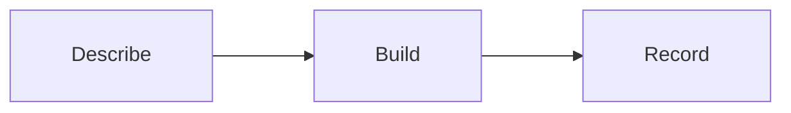

# puddleworks-factory

Builds, tests and validates a swamp extension from a spec. The spec can be a
file, an https URL or inline JSON, and anyone can write one.

| Takes in                                           | Puts out                                      |
| -------------------------------------------------- | --------------------------------------------- |
| an `app-spec/v1`: what to build                    | the extension's files and a `build-result/v1` |
| an `outcome-spec/v1`: what success looks like only | a starter `app-spec/v1` for you to finish     |

The contracts, each with an example, are in `docs/contracts/`:

- [outcome-spec.md](docs/contracts/outcome-spec.md): an agreed request that says
  what success looks like and who agreed it, but not how to build it
- [app-spec.md](docs/contracts/app-spec.md): what Factory builds from
- [build-result.md](docs/contracts/build-result.md): what a build produced and
  where it is

## How it works



1. **Describe** what the app should do.
2. **Build** a starter app in the app's own repo.
3. **Record** a receipt of where it went.

## What is in the package

| Kind     | Name                                          | What it does                                                                                                                                                                                                       |
| -------- | --------------------------------------------- | ------------------------------------------------------------------------------------------------------------------------------------------------------------------------------------------------------------------ |
| Model    | `@puddleworks/puddleworks-factory/draft`      | `render` reads a spec and writes the extension, its tests, a workflow, the manifest and the app docs; `visibility` recommends publishing it publicly or privately; `readiness` checks the review before publishing |
| Model    | `@puddleworks/puddleworks-factory/web`        | `serve` shows every app by stage, and each app's records, on a read-only page on 127.0.0.1                                                                                                                         |
| Workflow | `@puddleworks/puddleworks-factory-prefill`    | Runs `prefill`: turns an `outcome-spec/v1` into a starter `app-spec/v1`                                                                                                                                            |
| Workflow | `@puddleworks/puddleworks-factory-build`      | Runs `render` on the `puddleworks-factory` instance                                                                                                                                                                |
| Workflow | `@puddleworks/puddleworks-factory-visibility` | Runs `visibility`: checks the built app's repo and recommends public or private                                                                                                                                    |
| Workflow | `@puddleworks/puddleworks-factory-readiness`  | Runs `readiness`: checks the review report and that each acceptance criterion has a test, and writes a one-screen summary                                                                                          |
| Workflow | `@puddleworks/puddleworks-factory-result`     | Runs `result`: writes a `build-result/v1` for the last draft of a spec, with what was published                                                                                                                    |
| Skill    | `factory-build`                               | Takes a spec to a published extension: agree the spec, make the app repo, generate, build test-first, check, decide visibility, publish                                                                            |

## Use

Install the package and create the model instance once:

```bash
swamp extension pull @puddleworks/puddleworks-factory
swamp model create @puddleworks/puddleworks-factory/draft puddleworks-factory
```

### From an outcome spec

Run `/factory-build <path to the outcome spec>` in Claude Code. The skill
prefills an app spec, asks you to confirm the name, inputs, output, settings and
delivery, makes the app's own repo from `puddle-works/puddle-template` if it
does not exist yet (asking first), writes both specs to `spec/` there, and
generates the draft. It then builds the behaviour test-first, gets it through
the checks (tests, contracts, guardrails, quality 100%), recommends public or
private and asks you, has a fresh agent that has not seen the build review it
against the spec, opens a PR to the app repo and publishes once you confirm a
one-screen summary. Aim for about an hour. To prefill by hand instead:

```bash
swamp workflow run @puddleworks/puddleworks-factory-prefill \
  --input outcomeSpec=docs/contracts/outcome-spec.v1.example.json \
  --input out=$HOME/weekly-stock-count.app-spec.json
```

Fill in the blanks the run lists (see
[outcome-spec.md](docs/contracts/outcome-spec.md)), then build from that file.

### From an app spec

Build from a spec on disk, at an https URL, or inline. `targetDir` is a checkout
of the app's own repo and `repository` is its https URL:

```bash
swamp workflow run @puddleworks/puddleworks-factory-build \
  --input spec=docs/contracts/app-spec.v1.example.json \
  --input targetDir=$HOME/dev/obsidian-puddle-scanner \
  --input repository=https://github.com/example/obsidian-puddle-scanner

swamp workflow run @puddleworks/puddleworks-factory-build \
  --input spec=https://example.com/specs/scanner.json \
  --input targetDir=$HOME/dev/obsidian-puddle-scanner \
  --input repository=https://github.com/example/obsidian-puddle-scanner

swamp workflow run @puddleworks/puddleworks-factory-build \
  --input "spec=$(cat spec.json)" \
  --input targetDir=$HOME/dev/obsidian-puddle-scanner \
  --input repository=https://github.com/example/obsidian-puddle-scanner
```

`targetDir` must be a swamp repo (it has a `.swamp.yaml`), such as one made from
`puddle-works/puddle-template`. The draft goes in its root: the extension and
its test in `extensions/models/`, the workflow in `workflows/`, and
`manifest.yaml`, `README.md`, `LICENSE` and an app section in `CLAUDE.md`. An
existing `LICENSE` is kept, and the rest of `CLAUDE.md` is left alone. A spec
that breaks the contract writes nothing and lists every broken rule. Existing
files are kept unless you pass `--input overwrite=true`. The drafted package is
private; whether it goes public is decided once it is built (below).

Once it is built and passes its checks, ask for a recommendation. `quality` is
`swamp extension quality manifest.yaml --json | jq .percentage` in the app repo,
and `repoVisibility` is the GitHub repo's (`public` or `private`):

```bash
swamp workflow run @puddleworks/puddleworks-factory-visibility \
  --input name=obsidian-puddle-scanner --input quality=100 --input repoVisibility=private
swamp data query 'behavior("puddleworks-factory") && name == "visibility-obsidian-puddle-scanner"' \
  --select content --json | jq '.results[0] | {recommendation, canBePublic, checks, findings}'
```

It can be public only when the licence, repository, quality and secrets checks
pass (`canBePublic`). Anything that looks internal (home paths, internal hosts,
private IPs, real email addresses) or spec wording that says it is for one team
recommends private, and leaves the choice to you. Set `visibility:` in the
manifest and in `.github/workflows/ci.yml` before writing the review report: the
report is bound to the content hash, which the manifest is part of, so it is
never passed as `--visibility`.

Before publishing, have someone other than the builder review it: write the
review report from the publish dry run's skeleton, and map each acceptance
criterion in `spec/outcome-spec.v*.json` to the tests that check it in
`spec/acceptance.json`
(`{"criteria": [{"id": "AC1", "tests": ["a Deno.test name"], "manual": ""}]}`,
with `manual` saying how it was checked by hand when no test can). Then check
nothing is left. `review` is the report's path, from the dry run:

```bash
swamp workflow run @puddleworks/puddleworks-factory-readiness \
  --input name=obsidian-puddle-scanner \
  --input review=swamp-extension-review/_puddleworks_obsidian-puddle-scanner-HASH.json
swamp data query 'behavior("puddleworks-factory") && name == "readiness-obsidian-puddle-scanner"' \
  --select content --json | jq -r '.results[0] | .ready, .summary'
```

It is ready when the report matches the manifest's name and version with no
`issue` or `pending` verdict, every criterion has a test that exists or a manual
check, and the visibility check allows the manifest's visibility. The summary
fits on one screen: confirm publishing against it.

Write the build result once the draft is pushed. Add `pullRequest` once the pull
request is open, and `publishedVersion` with `publishedVisibility` once it is
published:

```bash
swamp workflow run @puddleworks/puddleworks-factory-result \
  --input name=obsidian-puddle-scanner \
  --input buildRef=draft/obsidian-puddle-scanner \
  --input out=$HOME/obsidian-puddle-scanner.build-result.json
```

## See what the Factory has done

The `web` model serves a read-only page on 127.0.0.1, in the style of Capture's
page. Create it once and run it until Ctrl-C:

```bash
swamp behavior create @puddleworks/puddleworks-factory/web factory-viewer
swamp behavior run factory-viewer serve --input port=3003
```

Then open <http://127.0.0.1:3003/>. Leave out `port` to have it pick a free one;
the run logs the address. It shows the draft behavior named
`puddleworks-factory`; set `draft` on `factory-viewer` to show another.

`/` lists every app under the last stage it has a record for, in Factory order,
newest first. To decide and Blocked are marked as waiting on you:

| Group              | When                                                         |
| ------------------ | ------------------------------------------------------------ |
| To decide          | prefilled, no draft yet                                      |
| Drafted            | a draft, no visibility check yet                             |
| Visibility checked | a visibility check, no readiness check yet                   |
| Blocked            | the latest readiness check has blockers                      |
| Ready to publish   | the latest readiness check passed, and nothing published yet |
| Released           | the build result records what was published                  |

Released means the build result has `published`, not just that there is a build
result: `result` is first run when the draft is pushed, before it is published.

`/apps/<name>` shows one app: its stages (prefill, draft, visibility, readiness,
pull request, published), then each record in that order, with links to the
outcome spec, the repo, the pull request and, once published, the package on the
registry. A record not written yet shows as not started. The page reloads when
the data changes.

The page only reads. It has no forms or buttons and no JSON API: the pages are
rendered on the server, and the event stream it reloads on says only that
something changed. Read the records themselves with `swamp data query`, as
above, and change them through the draft behavior's methods and the workflows.
Like Capture's page it answers only on 127.0.0.1, only to GET, and refuses
another Host, Origin or site, under a strict content security policy.

## Development

```bash
~/.swamp/deno/deno fmt --check
~/.swamp/deno/deno test -A --permit-no-files
swamp extension quality manifest.yaml
```

## Licence

[MIT](LICENSE)
